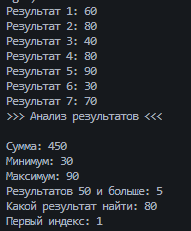

# Практическая работа №17
Автор: Волков Борис
Группа: ИСП-252
## Тема
Алгоритмы обработки массивов.
## Что реализовано
- сумма элементов;
- подсчёт элементов по условию;
- минимум и максимум;
- линейный поиск;
- поиск первого индекса.
## Короткие ответы
1. Почему максимум нельзя всегда начинать с `0`?
Ответ: потому что в массиве могут быть отрицательные числа
2. Что означает `-1` после поиска индекса?
Ответ: элемента в массиве нету
3. Чем сумма отличается от подсчёта элементов?
Ответ: в одном мы складываем сами элементы, в другом считаем кол-во элементов
## Результат

